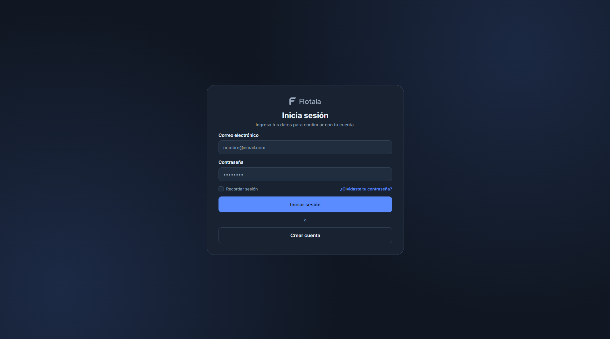
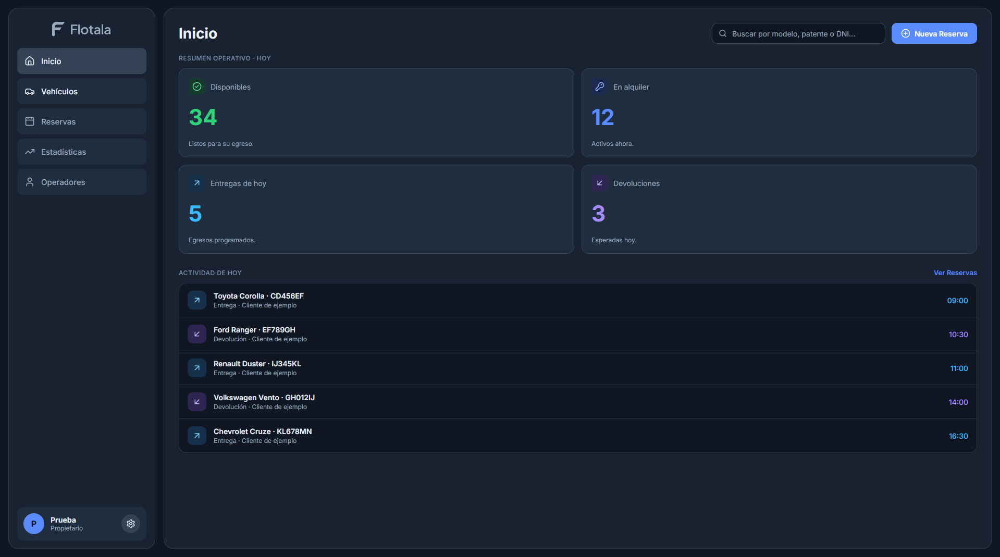
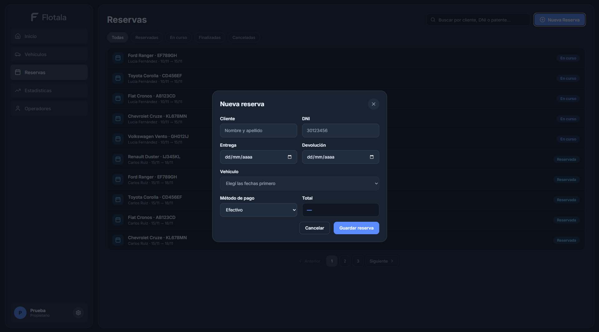

# Flotala

  

<h3 align="center">Simplificá la gestión de tu rentadora.</h3>

  Una plataforma diseñada para centralizar y optimizar la gestión diaria de empresas de alquiler de vehículos.

  
  
  

---

## Sobre el proyecto

**Flotala** es una plataforma SaaS en desarrollo, orientada a empresas de alquiler de vehículos que buscan simplificar y profesionalizar su gestión operativa.

El proyecto nace con el objetivo de reemplazar procesos manuales y herramientas dispersas por un sistema centralizado, intuitivo y accesible.

Desde la administración de la flota hasta el seguimiento de reservas, clientes y alquileres, Flotala busca ofrecer una solución integral para el funcionamiento diario de una rentadora.

## Vista previa

La aplicación se encuentra actualmente en desarrollo. Se irán incorporando actualizaciones a medida que avance la implementación de sus funcionalidades.

<!--

  

-->

## Funcionalidades

Las principales funcionalidades contempladas para la plataforma son:

- **Gestión de flota:** administración centralizada de vehículos, disponibilidad y características individuales.
- **Reservas:** creación, seguimiento y organización de reservas mediante un calendario.
- **Gestión de clientes:** registro de información y seguimiento del historial de alquileres.
- **Operaciones de alquiler:** registro de entregas, devoluciones y estado de los vehículos.
- **Precios y pagos:** configuración de tarifas, señas, pagos y saldos pendientes.
- **Estadísticas:** indicadores e información sobre el rendimiento del negocio.
- **Usuarios y permisos:** administración de empleados y asignación de diferentes niveles de acceso.

## Tecnologías

Las tecnologías y herramientas que están siendo utilizadas para el desarrollo son:

- **React**
- **Vite**
- **CSS**
- **PostgreSQL**

## Estado del proyecto

<kbd>EN DESARROLLO</kbd>

Flotala es un proyecto independiente actualmente en etapa de diseño e implementación.

La plataforma todavía no se encuentra disponible para uso comercial.
